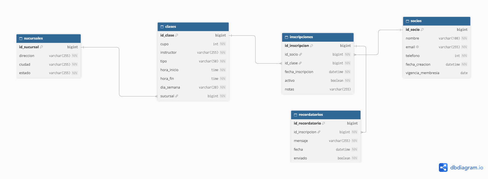
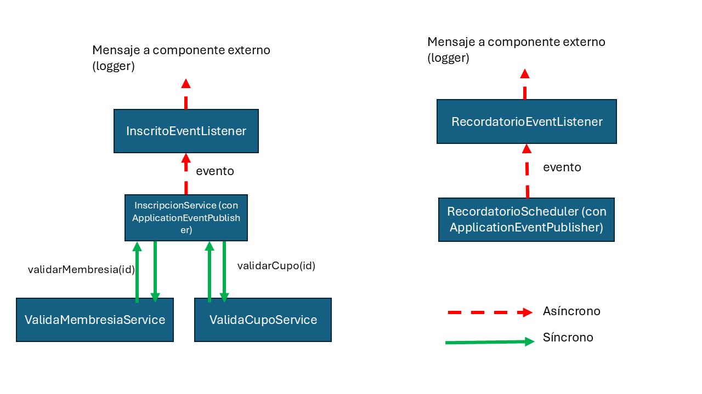

# API FitZone-SOA

API REST basada en Arquitectura Orientada a Servicios (SOA) y arquitectura guiada por eventos (EDA) para la administración integral de gimnasios y centros fitness: gestión de socios, sucursales, clases dirigidas, inscripciones con validaciones desacopladas (vigencia de membresía y control estricto de cupo) y generación programada de recordatorios automatizados.

Desarrollada con **Spring Boot 4**, **Spring Data JPA** y **MySQL**.

---

## Autor

**Gerardo Yeray Chelius Altamirano**  
7°B de Ingeniería en Sistemas Computacionales

---

## Diagrama de base de datos



---

## Tecnologías utilizadas

| Tecnología | Versión | Rol |
|---|---|---|
| Java | 21 | Lenguaje principal |
| Spring Boot | 4.1.1 | Framework base de desarrollo |
| Spring Data JPA | — | Capa de persistencia (ORM con Hibernate) |
| Spring Web MVC | — | API REST y controladores HTTP |
| Bean Validation | — | Validación declarativa de entidades y DTOs |
| Spring Scheduling | — | Ejecución de tareas programadas en segundo plano |
| Spring Events | — | Comunicación desacoplada basada en eventos en memoria |
| MySQL | 8+ | Base de datos relacional |
| MySQL Connector/J | — | Driver JDBC oficial |
| Maven | 3.9+ | Gestión de dependencias y construcción del proyecto |

---

## Requisitos previos

- **Java 21** instalado y configurado en el `PATH`.
- **MySQL 8+** en ejecución con una base de datos llamada `fitzone` (o el nombre configurado en `.env`).
- **Maven 3.9+** (o utilizar el wrapper `mvnw` / `mvnw.cmd` incluido en la raíz del proyecto).

---

## Variables de entorno

La aplicación carga automáticamente las credenciales y configuración de base de datos desde un archivo `.env` ubicado en la raíz del proyecto (a través de `spring.config.import=optional:file:./.env[.properties]`).

Crea un archivo **`.env`** en la raíz del proyecto (puedes tomar como referencia `.env.example`):

```env
DB_URL=jdbc:mysql://localhost:3306/fitzone?useSSL=false&allowPublicKeyRetrieval=true&serverTimezone=UTC
DB_USERNAME=tu_usuario
DB_PASSWORD=tu_contraseña
```

> **Importante:** El archivo `.env` contiene credenciales locales sensibles y **nunca** debe subirse al repositorio Git. Se encuentra protegido en el `.gitignore`.

| Variable | Descripción |
|---|---|
| `DB_URL` | Cadena de conexión JDBC hacia MySQL (ej. base de datos `fitzone`) |
| `DB_USERNAME` | Nombre del usuario con permisos en MySQL |
| `DB_PASSWORD` | Contraseña de acceso a MySQL |

---

## Instalación y ejecución

### 1. Clonar el repositorio

```bash
git clone https://github.com/G-Chelius-A/FitZone-SOA.git
cd FitZone-SOA
```

### 2. Crear la base de datos en MySQL

Accede a tu servidor MySQL y crea la base de datos:

```sql
CREATE DATABASE fitzone CHARACTER SET utf8mb4 COLLATE utf8mb4_unicode_ci;
```

### 3. Configurar las variables de entorno

Copia la plantilla `.env.example` o genera el archivo `.env`:

```bash
# Windows (PowerShell)
Copy-Item .env.example .env

# Linux / macOS
cp .env.example .env
```

Edita `.env` con tus credenciales locales de MySQL.

### 4. Compilar y ejecutar la aplicación

**Con Maven Wrapper:**

```bash
# Windows
.\mvnw.cmd spring-boot:run

# macOS / Linux
./mvnw spring-boot:run
```

**Con Maven instalado globalmente:**

```bash
mvn spring-boot:run
```

La API se iniciará en el puerto configurado: **`http://localhost:6767`**

> **Nota:** Al inicializar, Hibernate ejecuta `spring.jpa.hibernate.ddl-auto=update`, creando o actualizando automáticamente el esquema de tablas en la base de datos `fitzone`.

---

## Flujo principal y Arquitectura de Servicios (SOA / EDA)

El sistema aplica principios SOA separando responsabilidades en servicios de negocio especializados y comunicación asíncrona por eventos:

1. **Gestión de Socios y Sucursales**:
   - Registro de sucursales operativas (dirección, ciudad, estado).
   - Registro de socios con fecha de vigencia de membresía (por defecto un año a partir de su alta).
2. **Programación de Clases**:
   - Definición de clases deportivas según su disciplina (`YOGA`, `SPINNING`, `FUNCIONAL`), día de la semana, horario (`inicio`, `fin`), cupo máximo y sucursal.
3. **Orquestación de Inscripción (`POST /api/inscripciones`)**:
   - `InscripcionService` actúa como orquestador del proceso.
   - Invoca a `ValidaMembresiaService` para comprobar que la membresía del socio no se encuentre vencida (`vigenciaMembresia >= hoy`).
   - Invoca a `ValidaCupoService` para contar las inscripciones activas y rechazar si se ha alcanzado el límite (`inscritos >= cupo`).
   - Persiste la inscripción en estado activo (`activo=true`).
   - Dispara el evento de dominio `InscritoEvent` mediante `ApplicationEventPublisher`.
4. **Mensajería y Notificaciones Inmediatas (`InscritoEventListener`)**:
   - Escucha `InscritoEvent` tras la confirmación de la transacción (`@TransactionalEventListener`), registrando la auditoría del envío de confirmación de inscripción al socio.
5. **Generador y Despachador de Recordatorios (`RecordatorioScheduler` y `RecordatorioEventListener`)**:
   - Cada minuto (`@Scheduled(fixedRate = 60000)`), el scheduler evalúa las inscripciones activas, calcula el próximo horario de la clase y comprueba si la ventana de aviso (2 horas antes) ocurre en el minuto actual.
   - Si la condición se cumple, publica un `RecordatorioEvent`.
   - `RecordatorioEventListener` intercepta el evento, verifica idempotencia (evitando duplicados para la misma clase y fecha), genera el registro en la tabla `recordatorios` y simula el despacho del mensaje por correo o teléfono.

A partir de los servicios que se encuentran en el proyecto, puede observarse el siguiente flujo de mensajes y eventos:



`InscripcionService` valida el estado de la membresía con `ValidaMembresiaService` y el cupo disponible con `ValidaCupoService`. Tras persistir la inscripción, publica un evento escuchado por `InscritoEventListener`. De manera paralela e independiente, `RecordatorioScheduler` monitorea los horarios de las clases y emite eventos `RecordatorioEvent` que son procesados por `RecordatorioEventListener` para persistir y notificar a los socios en la ventana de tiempo oportuna.

---

## Endpoints de la API REST

Prefijo base: `http://localhost:6767`

### 1. Socios — `/api/socios`

| Método | Ruta | Descripción | Código de éxito |
|---|---|---|---|
| `GET` | `/api/socios` | Lista todos los socios registrados | `200 OK` |
| `GET` | `/api/socios/{id}` | Consulta el detalle de un socio por su ID | `200 OK` |
| `POST` | `/api/socios` | Registra un nuevo socio | `201 Created` |
| `PUT` | `/api/socios/{id}` | Actualiza datos o vigencia de un socio | `200 OK` |
| `DELETE` | `/api/socios/{id}` | Elimina el registro de un socio | `204 No Content` |

---

### 2. Sucursales — `/api/sucursales`

| Método | Ruta | Descripción | Código de éxito |
|---|---|---|---|
| `GET` | `/api/sucursales` | Lista todas las sucursales | `200 OK` |
| `GET` | `/api/sucursales/{id}` | Consulta una sucursal por su ID | `200 OK` |
| `POST` | `/api/sucursales` | Registra una nueva sucursal | `201 Created` |
| `PUT` | `/api/sucursales/{id}` | Actualiza datos de una sucursal existente | `200 OK` |
| `DELETE` | `/api/sucursales/{id}` | Elimina una sucursal | `204 No Content` |

---

### 3. Clases — `/api/clases`

| Método | Ruta | Descripción | Código de éxito |
|---|---|---|---|
| `GET` | `/api/clases` | Lista todas las clases programadas | `200 OK` |
| `GET` | `/api/clases/{id}` | Consulta el detalle de una clase por su ID | `200 OK` |
| `POST` | `/api/clases` | Registra una nueva clase fitness | `201 Created` |
| `PUT` | `/api/clases/{id}` | Actualiza horario, instructor o cupo de una clase | `200 OK` |
| `DELETE` | `/api/clases/{id}` | Elimina una clase | `204 No Content` |

**Valores válidos para `tipo` de clase:** `YOGA`, `SPINNING`, `FUNCIONAL`  
**Valores válidos para `dia` (`dia_semana`):** `MONDAY`, `TUESDAY`, `WEDNESDAY`, `THURSDAY`, `FRIDAY`, `SATURDAY`, `SUNDAY`

---

### 4. Inscripciones — `/api/inscripciones`

| Método | Ruta | Descripción | Código de éxito |
|---|---|---|---|
| `GET` | `/api/inscripciones` | Lista todas las inscripciones | `200 OK` |
| `GET` | `/api/inscripciones/{id}` | Obtiene el detalle de una inscripción por ID | `200 OK` |
| `POST` | `/api/inscripciones` | Registra una inscripción validando membresía y cupo | `201 Created` |
| `PUT` | `/api/inscripciones/{id}` | Actualiza los datos o estado de una inscripción | `200 OK` |
| `PATCH` | `/api/inscripciones/{id}/cancelar` | Cancela una inscripción marcándola como inactiva (`activo=false`) | `200 OK` |
| `DELETE` | `/api/inscripciones/{id}` | Elimina físicamente una inscripción | `204 No Content` |

---

### 5. Recordatorios — `/api/recordatorios`

| Método | Ruta | Descripción | Código de éxito |
|---|---|---|---|
| `GET` | `/api/recordatorios` | Lista todos los recordatorios generados | `200 OK` |
| `GET` | `/api/recordatorios/{id}` | Consulta el detalle de un recordatorio por ID | `200 OK` |

---

## Ejemplos de uso de la API

### Registrar una Sucursal

**`POST /api/sucursales`**

```json
// Petición
{
  "direccion": "Av. Reforma 123",
  "ciudad": "Veracruz",
  "estado": "Veracruz"
}
```

```json
// Respuesta — 201 Created
{
  "id": 1,
  "direccion": "Av. Reforma 123",
  "ciudad": "Veracruz",
  "estado": "Veracruz"
}
```

---

### Registrar un Socio

**`POST /api/socios`**

```json
// Petición
{
  "nombre": "Gerardo Yeray Chelius Altamirano",
  "email": "gerardo.chelius@fitzone.com",
  "telefono": "1234567890"
}
```

```json
// Respuesta — 201 Created
{
  "id": 1,
  "nombre": "Gerardo Yeray Chelius Altamirano",
  "email": "gerardo.chelius@fitzone.com",
  "telefono": "1234567890",
  "fechaCreacion": "2026-10-23T13:00:00",
  "vigenciaMembresia": "2027-10-23"
}
```

---

### Registrar una Clase

**`POST /api/clases`**

```json
// Petición
{
  "cupo": 15,
  "instructor": "Carlos Méndez",
  "tipo": "SPINNING",
  "inicio": "08:00:00",
  "fin": "09:00:00",
  "dia": "MONDAY",
  "sucursal": {
    "id": 1
  }
}
```

```json
// Respuesta — 201 Created
{
  "id": 1,
  "cupo": 15,
  "instructor": "Carlos Méndez",
  "tipo": "SPINNING",
  "inicio": "08:00:00",
  "fin": "09:00:00",
  "dia": "MONDAY",
  "sucursal": {
    "id": 1,
    "direccion": "Av. Reforma 123",
    "ciudad": "Veracruz",
    "estado": "Veracruz"
  }
}
```

---

### Registrar una Inscripción

**`POST /api/inscripciones`**

```json
// Petición
{
  "socio": {
    "id": 1
  },
  "clase": {
    "id": 1
  },
  "notas": "Asiste a su primera sesión"
}
```

```json
// Respuesta — 201 Created
{
  "id": 1,
  "socio": {
    "id": 1,
    "nombre": "Gerardo Yeray Chelius Altamirano",
    "email": "gerardo.chelius@fitzone.com"
  },
  "clase": {
    "id": 1,
    "tipo": "SPINNING",
    "dia": "MONDAY",
    "inicio": "08:00:00"
  },
  "fechaInscripcion": "2026-10-23T13:05:00",
  "activo": true,
  "notas": "Asiste a su primera sesión"
}
```

---

### Cancelar una Inscripción

**`PATCH /api/inscripciones/1/cancelar`**

```json
// Respuesta — 200 OK
{
  "id": 1,
  "activo": false,
  "notas": "Asiste a su primera sesión"
}
```

---

### Consultar Recordatorios Generados

**`GET /api/recordatorios`**

```json
// Respuesta — 200 OK
[
  {
    "id": 1,
    "mensaje": "¡Hola, Gerardo Yeray Chelius Altamirano. Tu clase de SPINNING iniciará en dos horas!",
    "fecha": "2026-10-26T06:00:00",
    "enviado": true
  }
]
```

---

## Manejo de códigos y errores

| Código HTTP | Significado | Ejemplos en la aplicación |
|---|---|---|
| `200 OK` | Operación exitosa | Consulta o actualización de socios, clases, sucursales e inscripciones. |
| `201 Created` | Recurso creado exitosamente | Alta de socio, clase, sucursal o inscripción. |
| `204 No Content` | Eliminación exitosa | Eliminación de socio, clase, sucursal o inscripción. |
| `400 Bad Request` | Petición incorrecta o datos inválidos | Faltan campos requeridos en el JSON o valores fuera de restricciones. |
| `403 Forbidden` | Operación denegada | Intento de inscripción cuando la membresía del socio está vencida (`validarMembresia`). |
| `404 Not Found` | Recurso inexistente | No se encontró el socio, clase, sucursal o inscripción solicitada. |
| `409 Conflict` | Conflicto de estado | Registro de socio con un correo electrónico duplicado o clase sin cupos disponibles (`validarCupo`). |

---

## Estructura del proyecto

```
src/main/java/com/api/fitzone/
├── FitzoneApplication.java               # Punto de entrada de Spring Boot (@EnableScheduling)
├── controllers/
│   ├── ClaseController.java              # Endpoints CRUD para clases de fitness
│   ├── InscripcionController.java        # Endpoints para inscripciones y cancelación
│   ├── RecordatorioController.java       # Consulta del historial de recordatorios
│   ├── SocioController.java              # Endpoints CRUD para socios
│   └── SucursalController.java           # Endpoints CRUD para sucursales
├── models/
│   ├── ClaseModel.java                   # Entidad Clase (tipo, cupo, horarios, día, sucursal)
│   ├── InscripcionModel.java             # Entidad Inscripción (socio, clase, estado, fecha)
│   ├── InscritoEvent.java                # Evento de dominio emitido tras una inscripción exitosa
│   ├── RecordatorioEvent.java            # Evento emitido al dispararse la ventana de 2h previas
│   ├── RecordatorioModel.java            # Entidad Recordatorio persistida en BD
│   ├── SocioModel.java                   # Entidad Socio (datos personales y vigencia membresía)
│   └── SucursalModel.java                # Entidad Sucursal
├── repositories/
│   ├── IClaseRepository.java             # Acceso a datos de clases
│   ├── IInscripcionRepository.java       # Conteo por clase activa y búsqueda de activos
│   ├── IRecordatorioRepository.java      # Verificación de existencia para idempotencia
│   ├── ISocioRepository.java             # Búsqueda por email y verificación
│   └── ISucursalRepository.java          # Acceso a datos de sucursales
└── services/
    ├── ClaseService.java                 # Lógica de clases y cálculo de fechas próximas
    ├── InscripcionService.java           # Orquestación de inscripciones y emisión de eventos
    ├── InscritoEventListener.java        # Suscriptor transaccional al evento de inscripción
    ├── RecordatorioEventListener.java   # Suscriptor que genera y persiste el recordatorio
    ├── RecordatorioScheduler.java        # Cron/Scheduler periódico para cálculo de recordatorios
    ├── RecordatorioService.java          # Consulta de recordatorios registrados
    ├── SocioService.java                 # Lógica y validación de socios y emails únicos
    ├── SucursalService.java              # Lógica de sucursales
    ├── ValidaCupoService.java            # Servicio especializado en validación de cupo
    └── ValidaMembresiaService.java       # Servicio especializado en validación de vigencia
```

---

> DISCLAIMER: Este proyecto es una muestra "representativa" del caso propuesto en clase. Evidentemente, no es algo digno de un entorno de producción. Para ello, se sugieren diferentes mejoras como el uso de RabbitMQ o Kafka según sea necesario como gestor de mensajes, implementar autenticación y autorización con JWT (algo planteado en el documento del ejercicio, pero llevado al código por simplicidad de la prueba), Dockerizar los servicios, entre otros aspectos más.
